<picture>
  <source media="(prefers-color-scheme: dark)" srcset="assets/header-dark.svg">
  <source media="(prefers-color-scheme: light)" srcset="assets/header-light.svg">
  
</picture>

  
  
  

## 👋 About me

I'm a **Backend Developer at [Zenvia](https://www.zenvia.com/)**, building APIs and services with **C# and .NET**. I care about clean architecture, well-tested code and shipping things securely — security and DevOps culture are the parts of the job I enjoy the most.

- 🎓 Graduated in **Systems Analysis and Development** (UniCEUB) and **Business Administration** (UnB)
- 🔐 Interested in application security, OWASP practices and CI/CD that catches problems early
- 🌍 Brazilian with deep family roots in Spain — I speak **Portuguese**, **Spanish** and **English**

## 🛠️ Tech stack

  

## ✨ Featured projects

<table>
  <tr>
    <td width="50%" valign="top">
      <h3>🌐 <a href="https://github.com/recioes/Esther_Recio">Personal page</a></h3>
      
My links page, rebuilt with <b>Astro</b>, an interactive <b>3D globe</b> in Three.js and <b>GSAP</b> motion. Trilingual (PT/EN/ES), strict Content-Security-Policy, unit tests, and CI/CD with CodeQL and automatic deploy to GitHub Pages.

      

        
        
        
        
      

      
<a href="https://recioes.github.io/Esther_Recio/">Live site →</a>

    </td>
    <td width="50%" valign="top">
      <h3>🌿 <a href="https://github.com/recioes/ihaircare.backend.app">iHairCare Backend</a></h3>
      
RESTful API for managing hair-care treatment schedules. <b>Clean Architecture</b> split into API, Core and Infrastructure layers, following <b>SOLID</b>, with the Factory pattern, dependency injection and Swagger docs.

      

        
        
        
        
      

      
<a href="https://github.com/recioes/ihaircare.backend.app">View repository →</a>

    </td>
  </tr>
  <tr>
    <td colspan="2" valign="top">
      <h3>🤖 <a href="https://recio.trd.br">Jéssica Recio · Sworn Translation</a></h3>
      
Trilingual website with its own visual identity for a sworn public translator, built by <b>orchestrating AI agents with OmO</b>: Claude (Opus, Sonnet), GPT (Astra, Sol) and DeepSeek (V4 Flash, V4 Pro), each model in the role where it performs best. Written brief and art direction, routing by cost, and tests plus a manual production deploy as the final gate.

      

        
        
        
        
      

      
<a href="https://recio.trd.br">Live site →</a>

    </td>
  </tr>
</table>

## 📫 Let's connect

I'm always happy to talk about backend, .NET and security. The best way to reach me is on **[LinkedIn](https://www.linkedin.com/in/estherrecio/)**, and you'll find all my other links on **[my page](https://recioes.github.io/Esther_Recio/)**.
